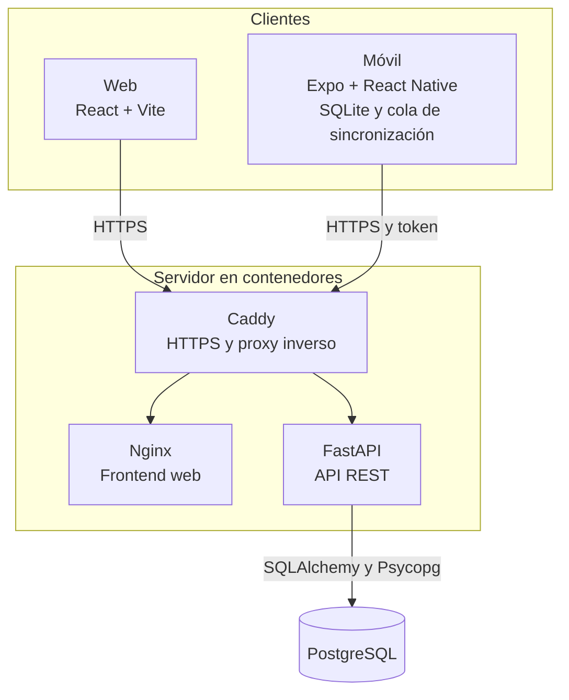

# Sistema de Gestión — Colmenares Tres Pinos

<div align="center">


### Plataforma web y móvil para el control operativo y la trazabilidad apícola

[](https://colmenarestrespinos.tech)


**Proyecto Capstone APT122 · Ingeniería en Informática · DUOC UC, sede Melipilla · 2026**

</div>

---

## Índice

- [Acerca del proyecto](#acerca-del-proyecto)
- [Problema y solución](#problema-y-solución)
- [Funcionalidades](#funcionalidades)
- [Roles de usuario](#roles-de-usuario)
- [Arquitectura](#arquitectura)
- [Tecnologías](#tecnologías)
- [Estructura del repositorio](#estructura-del-repositorio)
- [Inicio local](#inicio-local)
- [Variables de entorno](#variables-de-entorno)
- [Pruebas](#pruebas)
- [Despliegue](#despliegue)
- [Seguridad](#seguridad)
- [Documentación](#documentación)
- [Equipo](#equipo)

---

## Acerca del proyecto

**Sistema de Gestión — Colmenares Tres Pinos** es una plataforma web y móvil desarrollada para apoyar la gestión operativa de la empresa apícola Colmenares Tres Pinos.

Centraliza la información de apiarios, colmenas, inspecciones, tratamientos, transferencias de marcos e inventario. Cada registro contribuye a mantener la trazabilidad y el historial de las colmenas de los apiarios **Mandinga, Culiprán y Popeta**.

## Problema y solución

| Antes | Con el sistema |
|---|---|
| La información de aproximadamente 400–450 colmenas se registraba manualmente en los cajones. El historial y el seguimiento dependían de anotaciones en terreno. | Los códigos QR permiten identificar las colmenas. La aplicación móvil permite registrar información en terreno y trabajar sin conexión; al recuperar conectividad, sincroniza los registros con la plataforma. |

> **Diseño para terreno:** la experiencia prioriza pantallas simples y flujos claros para facilitar el uso durante las labores apícolas.

## Funcionalidades

### Plataforma web

| Módulo | Descripción |
|---|---|
| Panel de control | Resumen general y por apiario, con alertas de colmenas que requieren atención. |
| Apiarios y colmenas | Registro, edición, consulta, creación por lote y paginación. |
| Códigos QR | Generación e impresión de identificadores para las colmenas. |
| Inspecciones | Registro del estado general, los marcos y observaciones. |
| Por revisar | Consulta de colmenas pendientes de inspección. |
| Grupos y revisiones | Organización de inspecciones por grupos de colmenas. |
| Tratamientos | Registro de tratamientos aplicados por colmena. |
| Transferencias | Transferencia de marcos entre colmenas y control de capacidad. |
| Historial | Línea de tiempo de eventos asociados a cada colmena. |
| Inventario | Existencias, movimientos, niveles mínimos y retiro de materiales. |
| Reportes | Generación de reportes exportables a PDF y Excel. |
| Usuarios | Gestión de cuentas, roles y recuperación de contraseña por correo. |
| Auditoría | Registro consultable de acciones y cambios. |

### Aplicación móvil

- Escaneo de códigos QR con la cámara (`expo-camera`).
- Registro sin conexión mediante base de datos local (`expo-sqlite`).
- Sincronización de inspecciones y tratamientos con control de duplicados.
- Detección de conectividad (`@react-native-community/netinfo`).
- Almacenamiento seguro de sesión (`expo-secure-store`).
- Tutorial integrado para nuevos usuarios.

## Roles de usuario

| Rol | Uso principal | Permisos generales |
|---|---|---|
| **ADMIN** | Administración de la empresa y del sistema. | Acceso a usuarios, auditoría, reportes, inventario y configuración. |
| **APICULTOR** | Trabajo y registro de actividades en terreno. | Inspecciones, tratamientos y transferencias según permisos asignados. |

## Arquitectura

La solución utiliza una API REST compartida por la plataforma web y la aplicación móvil. La app puede almacenar información localmente mientras no hay conexión y sincronizarla posteriormente.



| Componente | Responsabilidad |
|---|---|
| Web y móvil | Administración, consulta y operación en terreno. |
| Caddy | Terminación HTTPS y enrutamiento de solicitudes. |
| Nginx | Entrega de los archivos de la aplicación web. |
| FastAPI | Endpoints, validación, reglas de negocio y control de acceso. |
| PostgreSQL | Persistencia relacional mediante SQLAlchemy y migraciones Alembic. |

## Tecnologías

| Área | Tecnologías |
|---|---|
| Web | React 19, Vite, Tailwind CSS 4, Lucide. |
| Móvil | Expo, React Native, TypeScript, expo-sqlite, expo-secure-store. |
| Backend | Python 3.12, FastAPI, Uvicorn, Pydantic. |
| Datos | PostgreSQL, SQLAlchemy 2, Psycopg 3, Alembic. |
| Autenticación | PyJWT, Argon2 (pwdlib), cookies de sesión y tokens Bearer. |
| Reportes y QR | ReportLab, openpyxl, qrcode, Pillow. |
| Infraestructura | Docker Compose, Caddy, Nginx. |
| Calidad | unittest, Vitest, Testing Library, Playwright, ESLint. |

## Estructura del repositorio

```text
.
├── backend/                 # API REST, modelos, servicios y pruebas
│   ├── app/
│   ├── alembic/             # Migraciones de base de datos
│   ├── migrations/          # Scripts SQL complementarios
│   ├── tests/
│   ├── Dockerfile
│   └── requirements.txt
├── frontend/                # Aplicación web React + Vite
│   ├── src/
│   ├── tests/
│   ├── e2e/
│   ├── Dockerfile
│   └── nginx.conf
├── mobile/                  # Aplicación Expo / React Native
│   ├── api/
│   ├── database/
│   └── sincronizacion/
├── docs/                    # Documentación del sistema
├── compose.yaml
├── compose.caddy.yaml
└── Caddyfile
```

## Inicio local

### Requisitos

- Git.
- Python 3.12.
- Node.js 20 o superior.
- PostgreSQL.
- Expo Go si se desea ejecutar la aplicación móvil en un teléfono.

### Obtener el código

```bash
git clone https://github.com/pednunez/Sistema-de-gestion---Colmenares-tres-pinos.git
cd Sistema-de-gestion---Colmenares-tres-pinos
```

### Backend

```bash
cd backend
python -m venv .venv

# Windows PowerShell
.venv\Scripts\Activate.ps1

# Linux o macOS
source .venv/bin/activate

pip install -r requirements.txt
# Crear backend/.env a partir de backend/.env.example y completar sus valores
alembic upgrade head
uvicorn app.main:app --reload
```

API: `http://localhost:8000` · Swagger: `http://localhost:8000/docs`

### Frontend web

En otra terminal, desde la raíz del repositorio:

```bash
cd frontend
npm install
# Crear frontend/.env a partir de frontend/.env.example
npm run dev
```

Web: `http://localhost:5173`

### Aplicación móvil

En otra terminal:

```bash
cd mobile
npm install
# Crear mobile/.env a partir de mobile/.env.example
npx expo start
```

Configura `EXPO_PUBLIC_API_URL` con una dirección accesible desde el teléfono. En una red local, el teléfono y el computador deben compartir la misma Wi-Fi y el backend debe aceptar conexiones de la red local. Consulta [`docs/API_MOVIL.md`](docs/API_MOVIL.md) si está disponible en esta rama.

## Variables de entorno

Usa los archivos `.env.example` de cada componente como referencia y completa los valores en archivos `.env` locales.

| Archivo | Variables representativas | Propósito |
|---|---|---|
| `backend/.env` | `DB_USER`, `DB_PASSWORD`, `DB_HOST`, `DB_PORT`, `DB_NAME` | Conexión a PostgreSQL. |
| `backend/.env` | `JWT_SECRET_KEY`, `ACCESS_TOKEN_EXPIRE_MINUTES` | Firma y duración de tokens. |
| `backend/.env` | `SMTP_*`, `PASSWORD_RESET_FRONTEND_URL` | Recuperación de contraseña por correo. |
| `backend/.env` | `SESSION_COOKIE_SECURE`, `CORS_ORIGINS`, `FRONTEND_URL` | Cookies, orígenes permitidos y URL de la plataforma. |
| `frontend/.env` | `VITE_API_URL` | Dirección de la API usada por la web. |
| `mobile/.env` | `EXPO_PUBLIC_API_URL`, `EXPO_PUBLIC_ENABLE_SYNC` | Dirección de la API y sincronización móvil. |

> No subas archivos `.env` ni credenciales al repositorio. Deben permanecer excluidos mediante `.gitignore`.

## Pruebas

### Backend

Desde la raíz del repositorio:

```bash
python backend/tests/run_isolated.py
```

Para ejecutar un archivo específico:

```bash
python backend/tests/run_isolated.py test_reportes.py
```

### Frontend

Desde la carpeta `frontend`:

```bash
npm test
npm run test:e2e
npm run lint
```

## Despliegue

La aplicación se ejecuta mediante Docker Compose detrás de Caddy, que administra HTTPS y enruta el tráfico al frontend y a la API.

| Dirección | Servicio |
|---|---|
| [colmenarestrespinos.tech](https://colmenarestrespinos.tech) | Plataforma web. |
| `api.colmenarestrespinos.tech` | API REST. |
| `pruebas.colmenarestrespinos.tech` | Entorno de pruebas, si está habilitado. |

Comando de referencia para iniciar los servicios:

```bash
docker compose -f compose.yaml -f compose.caddy.yaml up -d
```

## Seguridad

El sistema incorpora medidas de seguridad en sus componentes:

- Contraseñas protegidas con hash Argon2.
- Autenticación web mediante cookie de sesión y protección CSRF.
- Autenticación móvil mediante token Bearer.
- Control de acceso por roles en los endpoints.
- Separación de credenciales para la aplicación y las migraciones de base de datos.
- Registro de auditoría y `Correlation ID` para apoyar el seguimiento de solicitudes.
- Backend en contenedor ejecutado con usuario sin privilegios, según la configuración de despliegue.
- Secretos y credenciales configurados fuera del código fuente.

## Documentación

| Recurso | Contenido |
|---|---|
| [`docs/API_MOVIL.md`](docs/API_MOVIL.md) | Integración, autenticación y sincronización móvil, si está presente en la rama. |
| [`frontend/SEGURIDAD_DEPENDENCIAS.md`](frontend/SEGURIDAD_DEPENDENCIAS.md) | Información de revisión de dependencias, si está presente en la rama. |
| `/docs` | Documentación interactiva de FastAPI (Swagger), cuando la API está en ejecución. |
| `/redoc` | Documentación alternativa generada por FastAPI, cuando la API está en ejecución. |

## Equipo

| Integrante | Responsabilidad |
|---|---|
| **Pedro Núñez** | Product Owner · Frontend |
| **José Ballesteros** | Scrum Master · Backend · Base de datos |
| **Yarek Larraguibel** | Desarrollo móvil · Expo / React Native |

**Cliente:** Colmenares Tres Pinos  
**Institución:** DUOC UC · Sede Melipilla · Ingeniería en Informática · APT122  
**Metodología:** Scrum

---

<div align="center">

Proyecto académico desarrollado para Colmenares Tres Pinos · 2026

</div>
