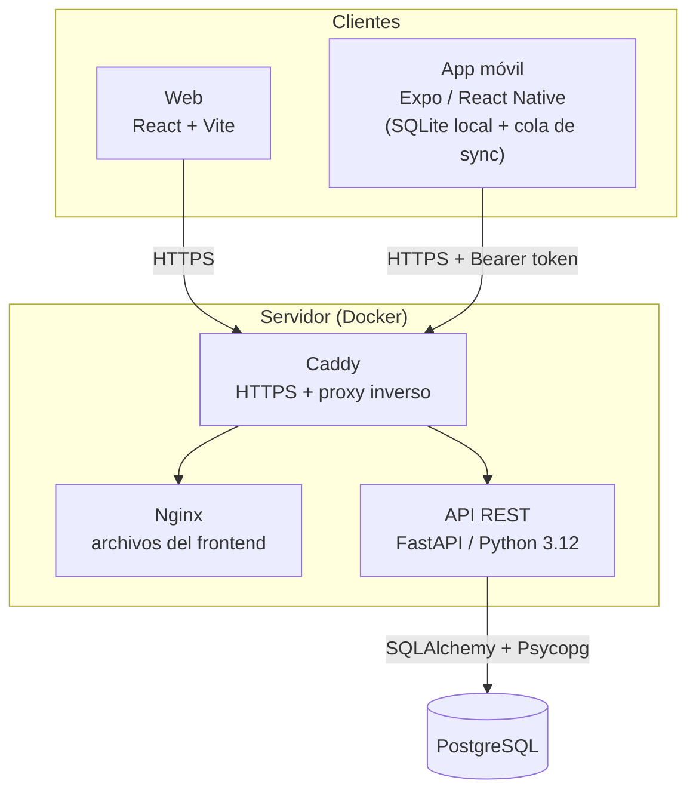

<div align="center">


# Sistema de Gestión — Colmenares Tres Pinos

**Plataforma web y móvil para el control operativo y la trazabilidad de colmenas**

[](https://colmenarestrespinos.tech)


Proyecto Capstone (APT122) · Ingeniería en Informática · DUOC UC Sede Melipilla · 2026

</div>

---

## Tabla de contenidos

- [Descripción](#descripción)
- [Problema y solución](#problema-y-solución)
- [Funcionalidades](#funcionalidades)
- [Usuarios y roles](#usuarios-y-roles)
- [Arquitectura](#arquitectura)
- [Tecnologías](#tecnologías)
- [Estructura del repositorio](#estructura-del-repositorio)
- [Instalación local](#instalación-local)
- [Variables de entorno](#variables-de-entorno)
- [Pruebas](#pruebas)
- [Despliegue](#despliegue)
- [Seguridad](#seguridad)
- [Documentación](#documentación)
- [Equipo](#equipo)

---

## Descripción

**Sistema de Gestión — Colmenares Tres Pinos** es una plataforma desarrollada como proyecto Capstone para la empresa apícola **Colmenares Tres Pinos**. Su objetivo es apoyar el control operativo y la trazabilidad de sus colmenas.

Reúne en un solo lugar la información de **apiarios, colmenas, inspecciones, tratamientos, transferencias de marcos y stock de materiales**. Así se puede seguir la historia completa de cada colmena, y el apicultor cuenta con datos reales para tomar decisiones.

El proyecto considera tres apiarios: **Mandinga**, **Culiprán** y **Popeta**.

---

## Problema y solución

| | |
|---|---|
| **Antes** | Cerca de 400 a 450 colmenas se gestionaban a mano, con marcas en los cajones. No existía historial ni datos digitales, y era difícil saber qué colmena necesitaba revisión o tratamiento. |
| **Ahora** | Cada colmena tiene un **código QR**. En terreno, el apicultor lo escanea con la **app móvil**, que también funciona **sin conexión**, y registra la inspección. Al volver a tener señal, los datos se sincronizan y quedan disponibles en la **plataforma web** con el historial, las alertas y los reportes. |

> **Principio de diseño:** la simplicidad es prioridad. Las pantallas están pensadas para usuarios con poca experiencia digital y para usarse en terreno.

---

## Funcionalidades

### Plataforma web

| Módulo | Descripción |
|---|---|
| **Dashboard** | Resumen general y por apiario, con alertas de colmenas que requieren atención |
| **Apiarios y colmenas** | Registro, edición y consulta. Incluye creación de colmenas por lote y paginación |
| **Códigos QR** | Generación e impresión del QR de cada colmena |
| **Inspecciones** | Registro detallado: estado general, estado de cada marco y observaciones |
| **Por revisar** | Lista de colmenas que llevan tiempo sin revisión |
| **Grupos y revisiones** | Revisión por grupos de colmenas ("colmena n de 5") |
| **Tratamientos** | Registro de medicamentos y tratamientos aplicados por colmena |
| **Transferencias** | Transferencia de marcos entre colmenas y control de capacidad |
| **Historial** | Línea de tiempo completa de cada colmena |
| **Stock** | Inventario de materiales, movimientos, mínimos y retiro de marcos a bodega |
| **Reportes** | Reportes exportables a **PDF** y **Excel** |
| **Usuarios** | Gestión de cuentas, roles y recuperación de contraseña por correo |
| **Auditoría** | Registro filtrable de quién hizo cada cambio y cuándo |

### App móvil (Expo / React Native)

- Escaneo de códigos QR con la cámara (`expo-camera`)
- **Modo sin conexión:** base de datos local en el teléfono (`expo-sqlite`)
- **Sincronización** de inspecciones y tratamientos con una cola de envío que evita registros duplicados
- Detección de conectividad (`@react-native-community/netinfo`)
- Sesión guardada de forma segura (`expo-secure-store`)
- Tutorial integrado para nuevos usuarios

---

## Usuarios y roles

| Rol | Descripción | Acceso |
|---|---|---|
| **ADMIN** | Dueño o administrador de la empresa | Acceso total: usuarios, auditoría, reportes, stock y configuración |
| **APICULTOR** | Personal de terreno | Registro de inspecciones, tratamientos y transferencias desde la web o el móvil |

---

## Arquitectura

Arquitectura por capas con un único backend (API REST) que atiende a dos clientes: la web y la app móvil.



| Capa | Responsabilidad |
|---|---|
| **Presentación** | Web para administración y consulta; app móvil para el trabajo en terreno |
| **Proxy** | Caddy entrega HTTPS automático y dirige el tráfico al frontend o a la API |
| **API** | Routers, esquemas Pydantic, servicios con la lógica de negocio y control de acceso |
| **Datos** | Modelos SQLAlchemy y migraciones con Alembic sobre PostgreSQL |

---

## Tecnologías

| Capa | Tecnología | Uso |
|---|---|---|
| **Frontend web** | React 19, Vite, Tailwind CSS 4, Lucide | Interfaz de administración y consulta |
| **Móvil** | Expo, React Native, TypeScript | App de terreno con escaneo QR y modo sin conexión |
| **Almacenamiento móvil** | expo-sqlite, expo-secure-store | Datos sin conexión y guardado seguro de la sesión |
| **Backend** | Python 3.12, FastAPI, Uvicorn | API REST y lógica de negocio |
| **Datos** | SQLAlchemy 2, Psycopg 3, Alembic | ORM, conexión y migraciones |
| **Base de datos** | PostgreSQL | Persistencia relacional |
| **Autenticación** | PyJWT, Argon2 (pwdlib) | Tokens, cookies de sesión y hash de contraseñas |
| **Reportes y QR** | ReportLab, openpyxl, qrcode, Pillow | Generación de PDF, Excel y códigos QR |
| **Pruebas** | unittest, Vitest, Testing Library, Playwright | Pruebas del backend, de la interfaz y end-to-end |
| **Infraestructura** | Docker Compose, Caddy, Nginx | Contenedores, HTTPS y publicación |
| **Diseño y gestión** | Figma, Scrum | Prototipos y desarrollo por sprints |

---

## Estructura del repositorio

```text
.
├── backend/                 # API REST (FastAPI)
│   ├── app/
│   │   ├── core/            # Autenticación, seguridad y dependencias
│   │   ├── models/          # Modelos SQLAlchemy
│   │   ├── routers/         # Endpoints por módulo
│   │   ├── schemas/         # Esquemas Pydantic
│   │   ├── services/        # Lógica de negocio
│   │   ├── database.py
│   │   └── main.py          # Punto de entrada
│   ├── alembic/             # Migraciones del esquema
│   ├── migrations/          # Scripts SQL de roles y permisos
│   ├── tests/               # Pruebas del backend
│   ├── Dockerfile
│   └── requirements.txt
├── frontend/                # Aplicación web (React + Vite)
│   ├── src/
│   │   ├── components/      # Componentes por módulo
│   │   ├── context/         # Sesión, datos, avisos y navegación
│   │   ├── hooks/
│   │   ├── pages/           # Vistas principales
│   │   └── services/        # Conexión con la API
│   ├── tests/               # Pruebas unitarias y de interfaz
│   ├── e2e/                 # Pruebas end-to-end (Playwright)
│   ├── Dockerfile
│   └── nginx.conf
├── mobile/                  # App móvil (Expo / React Native)
│   ├── api/                 # Cliente de la API
│   ├── database/            # Base local SQLite
│   └── sincronizacion/      # Cola y sincronización sin conexión
├── docs/
│   └── API_MOVIL.md         # Guía de la API para la app móvil
├── compose.yaml             # Backend + frontend
├── compose.caddy.yaml       # Proxy Caddy con HTTPS
└── Caddyfile
```

---

## Instalación local

### Requisitos

- Python 3.12
- Node.js 20 o superior
- PostgreSQL
- Git
- [Expo Go](https://expo.dev/go) en el teléfono (para la app móvil)

### 1. Clonar el repositorio

```bash
git clone https://github.com/pednunez/Sistema-de-gestion---Colmenares-tres-pinos.git
cd Sistema-de-gestion---Colmenares-tres-pinos
```

### 2. Backend

```bash
cd backend
python -m venv .venv

# Windows
.venv\Scripts\activate
# Linux / macOS
source .venv/bin/activate

pip install -r requirements.txt
cp .env.example .env          # Completar con tus credenciales
alembic upgrade head          # Crear o actualizar el esquema
uvicorn app.main:app --reload
```

API disponible en `http://localhost:8000` · Swagger en `http://localhost:8000/docs`

### 3. Frontend web

```bash
cd frontend
npm install
cp .env.example .env
npm run dev
```

Web disponible en `http://localhost:5173`

### 4. App móvil

```bash
cd mobile
npm install
cp .env.example .env          # Poner la IP del computador en EXPO_PUBLIC_API_URL
npx expo start
```

Escanea el QR de la terminal con **Expo Go**. El teléfono y el computador deben estar en la misma red Wi-Fi, y el backend debe iniciarse con `--host 0.0.0.0`. Hay más detalles en [`docs/API_MOVIL.md`](docs/API_MOVIL.md).

---

## Variables de entorno

Cada parte tiene su propio archivo `.env.example`. Las variables principales son:

| Archivo | Variable | Descripción |
|---|---|---|
| `backend/.env` | `DB_USER`, `DB_PASSWORD`, `DB_HOST`, `DB_PORT`, `DB_NAME` | Conexión a PostgreSQL con una cuenta de permisos restringidos |
| | `JWT_SECRET_KEY`, `ACCESS_TOKEN_EXPIRE_MINUTES` | Firma y duración de los tokens |
| | `SMTP_*`, `PASSWORD_RESET_FRONTEND_URL` | Correo de recuperación de contraseña |
| | `SESSION_COOKIE_SECURE`, `CORS_ORIGINS` | Cookies de sesión y orígenes permitidos |
| | `FRONTEND_URL` | URL pública usada en los códigos QR |
| `frontend/.env` | `VITE_API_URL` | URL del backend |
| `mobile/.env` | `EXPO_PUBLIC_API_URL` | URL del backend desde el teléfono |
| | `EXPO_PUBLIC_ENABLE_SYNC` | Activa la sincronización sin conexión |

> Los archivos `.env` **nunca** se suben al repositorio; están excluidos en `.gitignore`.

---

## Pruebas

### Backend

```bash
# Pruebas aisladas: no requieren PostgreSQL ni .env
python backend/tests/run_isolated.py

# Solo un archivo
python backend/tests/run_isolated.py test_reportes.py
```

Cubren control de acceso, sesiones con cookie, privilegios de la base de datos, auditoría, sincronización móvil, reportes, stock, transferencias y más.

### Frontend

```bash
cd frontend
npm test                  # Pruebas unitarias y de interfaz (Vitest + Testing Library)
npm run test:e2e          # Pruebas end-to-end (Playwright)
npm run lint              # Revisión de estilo con ESLint
```

---

## Despliegue

El sistema funciona en contenedores Docker detrás de **Caddy**, que obtiene y renueva los certificados HTTPS automáticamente.

| Dominio | Servicio |
|---|---|
| [`colmenarestrespinos.tech`](https://colmenarestrespinos.tech) | Plataforma web |
| `api.colmenarestrespinos.tech` | API REST |
| `pruebas.colmenarestrespinos.tech` | Entorno de pruebas |

```bash
docker compose -f compose.yaml -f compose.caddy.yaml up -d
```

---

## Seguridad

El proyecto sigue el enfoque **Security & Privacy by Design**:

- **Contraseñas** con hash **Argon2**
- **Autenticación** con cookie de sesión y protección CSRF en la web, y token Bearer en el móvil
- **Control de acceso por rol** (ADMIN / APICULTOR) en cada endpoint
- **Mínimo privilegio en la base de datos:** la app usa una cuenta restringida y las migraciones usan una cuenta propietaria separada
- **Auditoría** de las acciones relevantes
- **Correlation ID** en cada petición para rastrear errores
- **Contenedores sin root** (el backend corre con un usuario sin privilegios)
- Secretos fuera del código, en variables de entorno

---

## Documentación

| Documento | Contenido |
|---|---|
| [`docs/API_MOVIL.md`](docs/API_MOVIL.md) | Conexión, autenticación y sincronización de la app móvil |
| [`frontend/SEGURIDAD_DEPENDENCIAS.md`](frontend/SEGURIDAD_DEPENDENCIAS.md) | Revisión de seguridad de dependencias |
| `/docs` (Swagger) y `/redoc` | Documentación interactiva de la API, generada por FastAPI |

---

## Equipo

| Integrante | Rol |
|---|---|
| **Pedro Núñez** | Product Owner · Frontend |
| **José Ballesteros** | Scrum Master · Backend · Base de datos |
| **Yarek Larraguibel** | Desarrollo móvil (Expo / React Native) |

**Cliente:** Colmenares Tres Pinos  
**Institución:** DUOC UC — Sede Melipilla · Ingeniería en Informática · Proyecto APT (APT122)  
**Metodología:** Scrum, 5 sprints

---

<div align="center">

Proyecto académico desarrollado para Colmenares Tres Pinos · 2026

</div>
